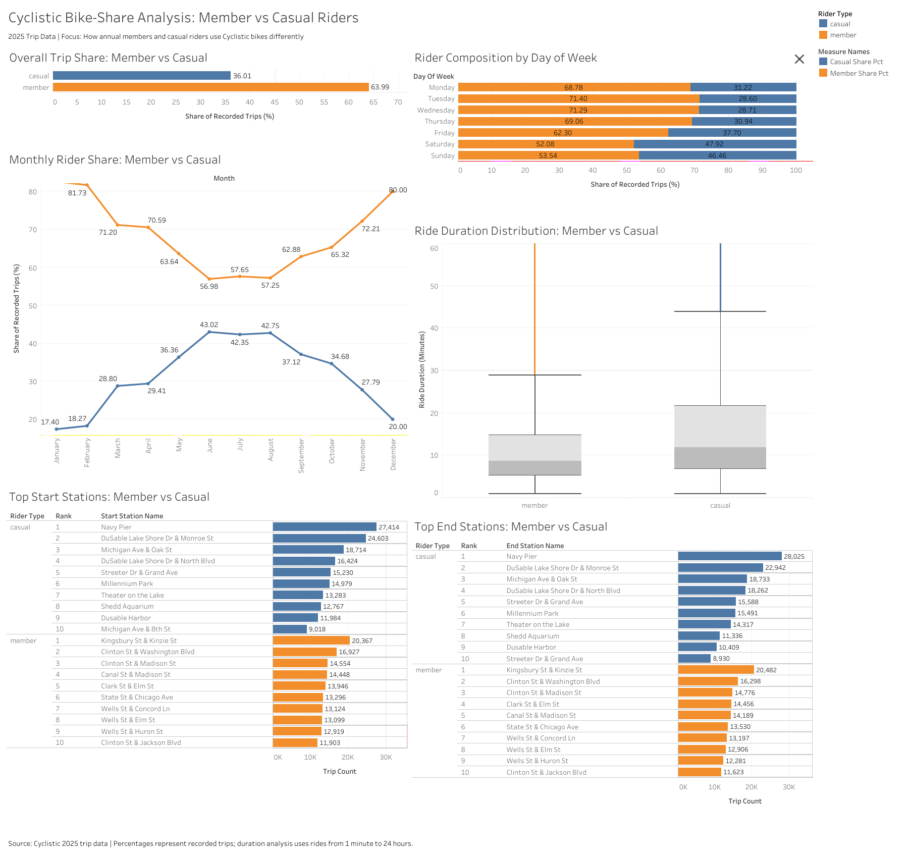

# Cyclistic Bike-Share Analysis (2025)
### Understanding Annual Members vs Casual Riders

An end-to-end data analytics project examining **5.55 million bike-share trips** from January to December 2025 to identify behavioral differences between annual members and casual riders and develop data-driven membership conversion strategies.

**Tools:** Python | SQL (DuckDB) | Tableau | Jupyter Notebook

**[View Interactive Tableau Dashboard](https://public.tableau.com/views/CyclisticBike-ShareAnalysis2025MembervsCasualRiders/CyclisticBike-ShareAnalysisMembervsCasualRiders?:language=en-US&publish=yes)**

---

## 1. Business Problem

Cyclistic is a fictional bike-share company operating in Chicago. Its marketing team aims to increase annual memberships by converting casual riders into annual members.

The key business question addressed in this project is:

**How do annual members and casual riders use Cyclistic bikes differently?**

The analysis identifies differences in trip frequency, timing, duration, seasonal activity, bike preferences, and station usage to develop targeted marketing recommendations.

## 2. Dataset Overview

The analysis uses 12 monthly Divvy trip-data CSV files covering January–December 2025.

| Dataset information | Details |
|---|---|
| Analysis period | January–December 2025 |
| Total recorded trips | 5,552,994 |
| Total columns | 21 |
| Member trips | 3,553,497 |
| Casual trips | 1,999,497 |
| Data granularity | Individual trip records |

**Data source:** [Divvy Public Trip Data](https://divvybikes-marketing.lyft.net/system-data)

The data contains trip identifiers, bike types, start and end timestamps, station information, coordinates, and rider categories.

The dataset does not contain individual customer identifiers. Therefore, the findings describe recorded trips rather than unique customers.

## 3. Tools and Technologies

| Tool | Application |
|---|---|
| Python | Data cleaning, transformation, and exploratory analysis |
| Pandas | Data manipulation and aggregation |
| Matplotlib | Exploratory data visualization |
| DuckDB SQL | Business analysis and analytical queries |
| Tableau | Interactive dashboards and business visualizations |
| Jupyter Notebook | Documentation and execution of the analysis workflow |

## 4. Project Workflow

### Phase 1: Data Processing and Cleaning

**Notebook:** `01_process_cyclistic_data.ipynb`

- Imported and processed all 12 monthly datasets.
- Standardized data types and timestamp fields.
- Checked missing values and duplicate records.
- Validated timestamp ordering and ride durations.
- Checked station information and geographical coordinates.
- Created derived fields including `ride_duration_seconds`, `ride_length`, `day_of_week_num`, and `day_of_week`.
- Applied a reusable cleaning function across all monthly datasets.
- Combined the cleaned monthly datasets into a single annual dataset.
- Performed final data-quality validation.

**Processing result:** All 5,552,994 original records were retained in the annual dataset.

Unusual observations were flagged and documented rather than automatically deleted.

### Phase 2: Exploratory and Business Analysis

**Notebook:** `02_analyze_cyclistic_data.ipynb`

The analysis examined:

- Overall member vs casual trip distribution.
- Daily and weekday/weekend riding patterns.
- Monthly and seasonal trip activity.
- Ride duration distributions.
- Bike-type preferences.
- Start and end station activity.
- Cross-analysis of rider type with time, month, bike type, and station usage.

DuckDB SQL was used for structured business analysis and validation.

### Phase 3: Data Visualization

Created Tableau-ready summary datasets and developed visualizations to communicate the differences between member and casual riding behavior.

The final dashboard brings together the major findings of the analysis.

### Phase 4: Business Recommendations

Developed three targeted membership-conversion strategies based on the observed trip patterns.

## 5. Key Findings

### Finding 1: Members account for the majority of recorded trips

| Rider category | Recorded trips | Share |
|---|---:|---:|
| Members | 3,553,497 | 63.99% |
| Casual riders | 1,999,497 | 36.01% |
| Total | 5,552,994 | 100% |

Members account for approximately two-thirds of annual recorded trips, while casual riders still contribute almost two million trips.

### Finding 2: Casual activity is substantially higher on weekends

| Period | Casual trip share | Member trip share |
|---|---:|---:|
| Weekdays | 31.54% | 68.46% |
| Weekends | 47.26% | 52.74% |

The casual share increases by **15.72 percentage points** on weekends compared with weekdays.

Saturday records the highest casual share at 47.92%, followed by Sunday at 46.46%.

### Finding 3: Casual riders take longer trips

Standard duration population: 1 minute to 24 hours.

| Measure | Casual riders | Members |
|---|---:|---:|
| Mean duration | 19.91 min | 12.18 min |
| Median duration | 11.89 min | 8.74 min |

Casual trips have an average duration approximately **7.73 minutes longer** than member trips.

### Finding 4: Riding activity varies seasonally

- June recorded the highest casual trip share at **43.02%**.
- August recorded the highest overall monthly trip volume at **790,317 trips**.
- Casual activity represented a larger share of riding during the middle of the year.

### Finding 5: Casual station activity is concentrated at different locations

Navy Pier recorded the highest casual trip volume among the analyzed station combinations:

- Start station: **27,414 casual trips**
- End station: **28,025 casual trips**

Member activity was led by different locations, including Kingsbury St & Kinzie St and Clinton St & Washington Blvd.

### Supporting finding: Bike-type differences are relatively small

- Casual electric-bike share: **66.36%**
- Member electric-bike share: **64.11%**
- Difference: **2.25 percentage points**

Compared with trip timing and duration, bike type shows a smaller difference between rider categories.

## 6. Business Recommendations

### Recommendation 1: Focus membership campaigns on weekends

Target casual riders from Friday through Sunday, when their share of recorded trips is substantially higher.

Test membership prompts through the Cyclistic app and other digital channels.

### Recommendation 2: Develop membership messaging for longer trips

Test targeted membership messages for casual riders who record relatively longer trips.

Highlight the value, practical benefits, and convenience of annual membership.

### Recommendation 3: Target high-casual-activity stations

Pilot membership-conversion campaigns at stations with high casual trip volumes.

Navy Pier is a potential starting location. Test QR codes, digital signage, and app-based membership prompts.

**Measurement approach:** These strategies should be tested through controlled campaigns. Track membership conversion rates, new annual memberships, campaign engagement, and performance against suitable comparison groups.

## 7. Tableau Visualizations

### Final Analytical Dashboard



### Individual Visualizations

1. [Overall Trip Share](visualizations/01_Overall%20Trip%20Share.png)
2. [Rider Composition by Week](visualizations/02_Rider%20Composition%20by%20Week.png)
3. [Monthly Rider Share](visualizations/03_Monthly%20Rider%20Share.png)
4. [Ride Duration Distribution](visualizations/04_Ride%20Duration%20Distribution.png)
5. [Top Start Stations](visualizations/05_Top%20Start%20Stations.png)
6. [Top End Stations](visualizations/06_Top%20End%20Stations.png)

**[Explore the Interactive Tableau Dashboard](https://public.tableau.com/views/CyclisticBike-ShareAnalysis2025MembervsCasualRiders/CyclisticBike-ShareAnalysisMembervsCasualRiders?:language=en-US&publish=yes)**

## 8. Repository Structure

```text
Cyclistic-Bike-Share-Analysis-2025/
│
├── notebooks/
│   ├── 01_process_cyclistic_data.ipynb
│   ├── 02_analyze_cyclistic_data.ipynb
│   └── README.md
│
├── outputs/
│   ├── tableau_overall.csv
│   ├── tableau_weekday.csv
│   ├── tableau_monthly.csv
│   ├── tableau_start_stations.csv
│   ├── tableau_end_stations.csv
│   └── README.md
│
├── visualizations/
│   ├── 01_Overall Trip Share.png
│   ├── 02_Rider Composition by Week.png
│   ├── 03_Monthly Rider Share.png
│   ├── 04_Ride Duration Distribution.png
│   ├── 05_Top Start Stations.png
│   ├── 06_Top End Stations.png
│   ├── 07_Final_Dashboard.png
│   └── README.md
│
├── .gitignore
└── README.md
```

## 9. Data Quality and Limitations

- All 5,552,994 source records were retained.
- No duplicate ride IDs or exact duplicate rows were found.
- No missing start or end timestamps were found.
- Twenty-nine negative-duration records were identified and documented. They were excluded only from duration-specific calculations.
- Short-duration, extreme-duration, and month-boundary observations were flagged rather than automatically deleted.
- Missing station information was retained in the master dataset and excluded only from analyses requiring those fields.
- No individual customer identifiers were available.

These limitations mean that the results describe observed trip patterns and do not establish individual customer preferences or the causes of riding behavior.

The recommendations are proposed marketing experiments, not proven conversion outcomes.

## 10. Running the Project

To reproduce the analysis:

1. Download the 12 monthly CSV files from the [official Divvy trip-data source](https://divvybikes-marketing.lyft.net/system-data).
2. Place the files inside a local `data/raw/` directory, preserving their original filenames.
3. Install the required Python packages:

```bash
pip install pandas pyarrow duckdb matplotlib jupyter
```

4. Run `01_process_cyclistic_data.ipynb` to clean, validate, and combine the monthly datasets.
5. Run `02_analyze_cyclistic_data.ipynb` to perform exploratory analysis and SQL business analysis.
6. Use the Tableau-ready CSV files in `outputs/` for visualization.

**Note:** The raw monthly CSV files and cleaned annual Parquet dataset are intentionally excluded from this GitHub repository because of their size. Download the original data separately before running the notebooks. The source data is subject to the provider's Data License Agreement.

---

### Project Conclusion

This project demonstrates an end-to-end data analytics workflow combining Python-based data preparation, DuckDB SQL business analysis, and Tableau visualization.

The analysis identifies meaningful differences between annual members and casual riders, particularly in trip timing, duration, seasonal activity, and station usage. These insights provide a foundation for developing and testing more targeted annual membership-conversion strategies.
